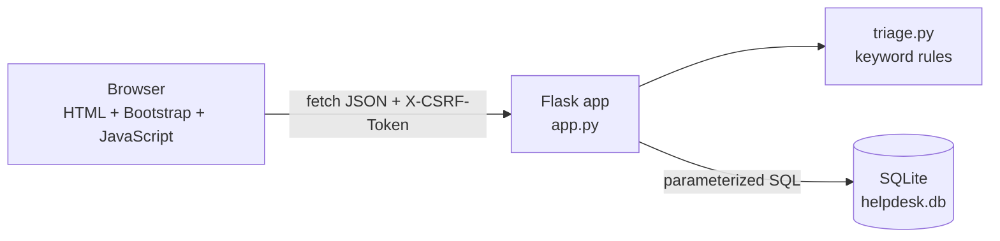
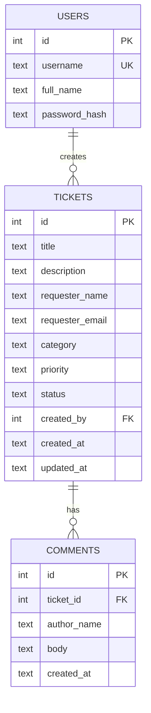
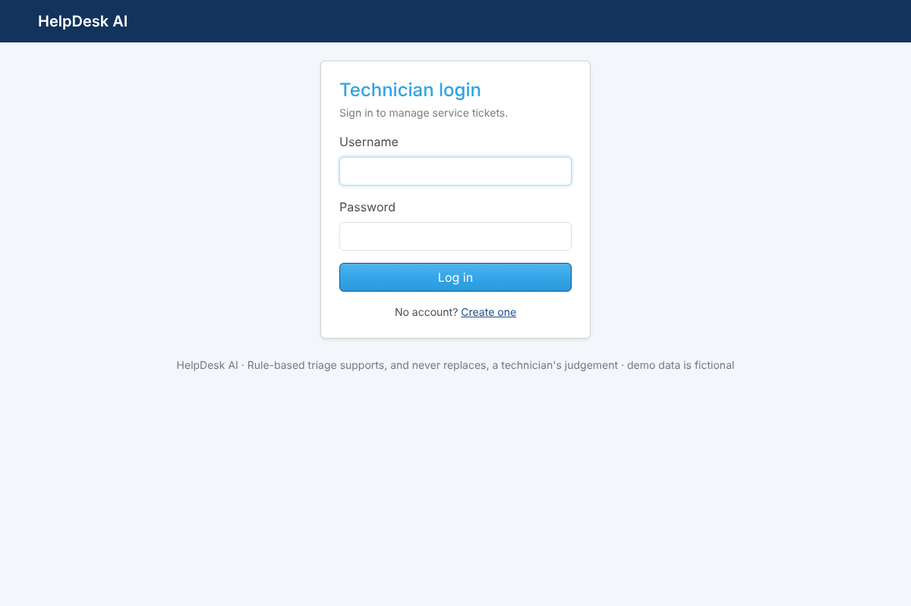
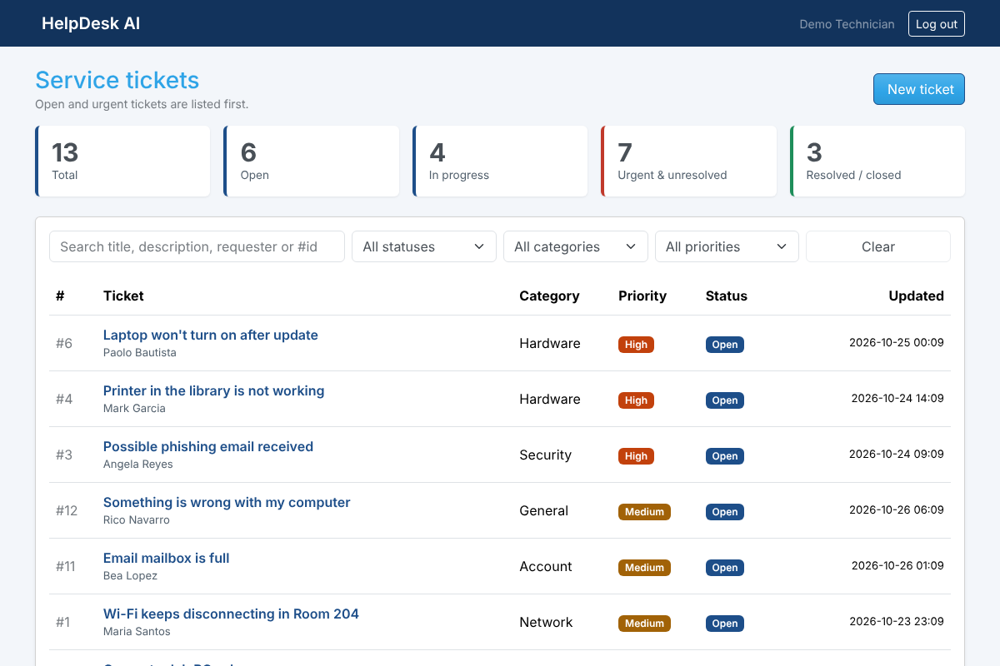
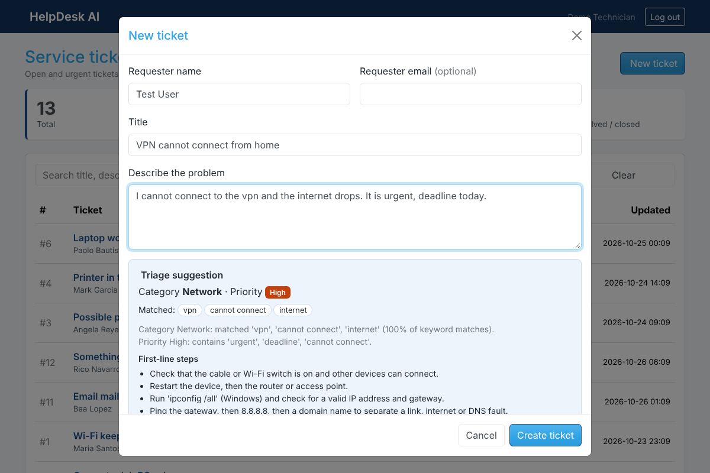
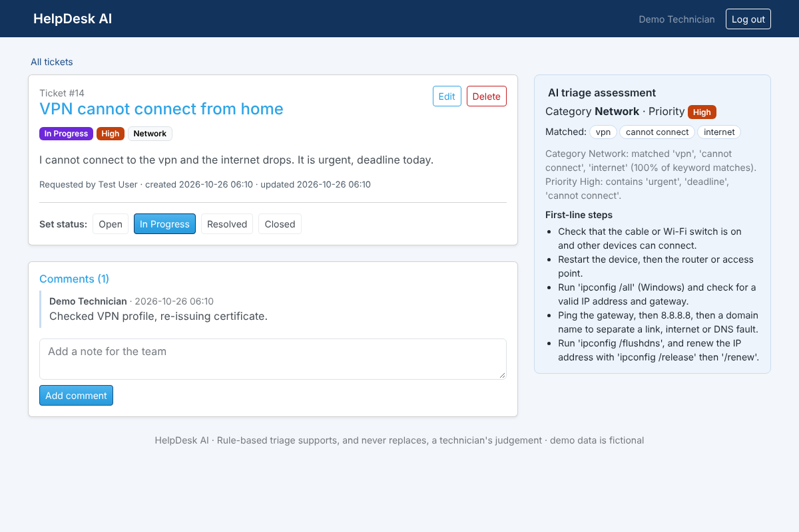

# 1. HelpDesk AI: AI-Assisted IT Help Desk and Service Ticket Management System

> BSIT Industry-Ready Portfolio · Project 3 (Specialization Project: Full-Stack Development)
> Datamex College of Saint Adeline, Parañaque City

Live demo: https://helpdesk-ai-gyrc.onrender.com
Source code:  https://github.com/angelodalezamora-boop/helpdesk-ai
Portfolio: https://github.com/angelodalezamora-boop/Zamora_Portfolio

---

## 2. Project Overview

HelpDesk AI is a web application where an IT support team records service tickets, and gets an automatic **triage suggestion** for each one: a category (Network, Hardware, Software, Account, Security or General), a priority (Low, Medium, High or Critical), the exact words that caused the suggestion, and first-line troubleshooting steps. Technicians can accept the suggestion or override it, then track the ticket from Open to Closed with comments.

The "AI-assisted" part is a **transparent, rule-based classifier** (see `triage.py`). It is not a machine-learning model and it calls no external AI service. Every suggestion can be traced to a keyword, so a technician can check it instead of trusting a black box.

This project builds on Project 1 (EduWatch): same stack and security approach, but a different problem domain, ticket workflow, text classification and an API protected by CSRF headers.

## 3. Problem Statement

A school or small office help desk receives problems by chat, phone and email. Tickets are often categorized by hand, urgent ones (a ransomware warning, a whole lab offline) wait in the same pile as simple questions, and new technicians repeat the same first-line diagnostic questions every time. The result is slow response to what matters most.

## 4. Objectives

1. Store tickets and comments in one database with full create, read, update and delete.
2. Provide secure technician accounts; every page and API route except login/register needs a session.
3. Suggest a category and priority from the ticket text, and explain why.
4. Show the most urgent unresolved tickets first.
5. Suggest first-line troubleshooting steps for the detected category.
6. Demonstrate full-stack skills: UI, database, REST-style JSON API, validation, search, authentication, error handling and automated tests.

## 5. Target Users

- **IT support technicians** who receive, triage and resolve tickets.
- **Help desk leads** who need to see urgent unresolved work.
- **Requesters** (students, staff) are recorded on tickets but do not log in. A requester self-service portal is listed under Future Improvements.

## 6. Technologies Used

| Layer | Technology |
|---|---|
| Frontend | HTML5, CSS3, JavaScript (ES6, `fetch`), Bootstrap 5, Bootstrap Icons |
| Backend | Python 3, Flask |
| Database | SQLite (Python's built-in `sqlite3`) |
| "AI" | Rule-based keyword triage (`triage.py`), no external service |
| Security | Werkzeug password hashing, Flask sessions, CSRF tokens for forms and API, parameterized SQL, output escaping, security headers |
| Testing | Python `unittest` and Flask's test client |
| Deployment | Gunicorn, Render (`render.yaml`) |
| Tools | Git, GitHub, VS Code |

## 7. System Features

| Requirement | How it is met |
|---|---|
| **User interface** | Responsive Bootstrap pages: login, register, dashboard, ticket detail |
| **Database** | SQLite with three related tables, foreign keys and `CHECK` constraints |
| **CRUD operations** | Create, read, update and delete tickets; add and delete comments; quick status changes |
| **Validation** | Server-side checks on every field; field-level messages in the form |
| **Search** | Search by title, description, requester or ticket number, plus status, category and priority filters |
| **Authentication** | Register, log in and log out; sessions with hashed passwords |
| **Error handling** | JSON errors with proper status codes (400, 401, 403, 404, 405, 409), friendly error pages, and a global handler for unexpected errors |

Also included: live triage preview while typing a new ticket, summary cards, urgent-first ordering, and demo data.

**How triage works** (`triage.py`)

| Decision | Rule |
|---|---|
| Category | Count keyword matches per category as whole words, case-insensitive. A match in the **title counts double**. The highest score wins; on a tie, Security wins, then Network, Hardware, Software, Account. No match gives **General**. |
| Priority: Critical | Contains words such as `ransomware`, `breach`, `data loss`, `server down`, `all users`, `smoke`. |
| Priority: High | Contains words such as `urgent`, `cannot work`, `deadline`, `crash`, `locked`, `no internet`, or the category is **Security** (never ranked lower than High). |
| Priority: Low | Looks like a request or question: `question`, `how to`, `no rush`, `when possible`. |
| Priority: Medium | Everything else. |
| Confidence | The winning category's share of all keyword score, shown as a percentage. |

## 8. System Architecture



- **Browser:** server-rendered pages for layout and login; JavaScript calls the JSON API for the data screens and escapes all ticket text before showing it.
- **Flask (`app.py`):** routes, authentication, CSRF checks, validation, error handling.
- **`triage.py`:** pure functions with no database access, which makes them easy to test.
- **SQLite:** one file, created automatically on first run.

```
helpdesk-ai/
├── app.py            Flask app: routes, auth, validation, API
├── triage.py         Ticket triage rules (the "AI-assisted" part)
├── schema.sql        Database tables
├── seed.py           Demo data loader
├── requirements.txt
├── render.yaml       One-click deployment settings for Render
├── templates/        HTML pages (Jinja2)
├── static/           CSS and JavaScript
├── tests/            Automated tests (53)
└── docs/             Screenshots, AI usage log
```

## 9. Database Design



- Deleting a ticket deletes its comments (`ON DELETE CASCADE`). Deleting a user keeps their tickets (`ON DELETE SET NULL`).
- `CHECK` constraints limit category, priority and status to the allowed values.
- The full SQL is in [`schema.sql`](schema.sql).

## 10. Screenshots

| Login | Dashboard |
|---|---|
|  |  |

| New ticket with live triage | Ticket detail with AI assessment |
|---|---|
|  |  |

> These were captured in a test environment. Replace them with screenshots from your own machine after running the app.

## 11. Installation

You need **Python 3.10 or newer** and **Git**.

```bash
# 1. Get the code
git clone https://github.com/YOUR-USERNAME/helpdesk-ai.git
cd helpdesk-ai

# 2. Create and activate a virtual environment
python -m venv .venv
.venv\Scripts\activate          # Windows
# source .venv/bin/activate     # macOS / Linux

# 3. Install the dependencies
pip install -r requirements.txt

# 4. (Optional) load demo data and a demo account
python seed.py

# 5. Start the app
python app.py
```

Open <http://127.0.0.1:5000>.

**Configuration (optional)**

| Environment variable | Purpose |
|---|---|
| `SECRET_KEY` | Signs login sessions. If not set, a random key is created in `.secret_key` (ignored by Git). **Set a strong value on any deployed site.** |
| `DATABASE` | Path to the SQLite file. Default: `helpdesk.db` in the project folder. |
| `SESSION_COOKIE_SECURE=1` | Send the session cookie over HTTPS only. Turn this on when deployed. |
| `FLASK_DEBUG=1` | Developer mode with auto-reload. Never use on a public server. |

**Deploying (Render)**

1. Push the repository to GitHub.
2. In Render choose **New + → Blueprint** and select the repository. `render.yaml` sets the build command, the start command (`gunicorn app:app`), a generated `SECRET_KEY`, and secure cookies.
3. After the first deploy, open the service **Shell** and run `python seed.py` if you want the demo account.
4. Copy the service URL into the **Live demo** line above and into your portfolio.

> The free Render plan has a temporary disk, so the SQLite file resets when the service restarts. That is fine for a demo; use a managed database for real use.

## 12. How to Use

1. **Log in.** With demo data: username `tech`, password `HelpDesk123!`. Otherwise click *Create one* and register.
2. **Dashboard.** See the totals, search tickets, and filter by status, category or priority. Urgent open tickets are listed first.
3. **New ticket.** Click *New ticket*. As you type the title and description, the triage suggestion updates. Leave category and priority on *Use the suggestion*, or choose your own.
4. **Open a ticket.** Click its title to see the AI assessment (matched keywords, reasons, first-line steps), add comments, and change the status.
5. **Edit or delete.** Use the buttons on the ticket page.

## 13. Testing

Run the automated tests from the project folder:

```bash
python -m unittest discover -s tests -v
```

**Latest result: 53 tests, all passing.**

| Area | What is tested |
|---|---|
| Triage engine | Each category, security never below High, critical and low wording, unknown text gives General, title counts double, whole-word matching (`app` does not match `happened`), empty and `None` input |
| Authentication | API and pages need login, bad password rejected, logout ends the session, missing form CSRF token rejected, API writes without the CSRF header rejected (403), open redirect blocked, duplicate username, weak password, password stored as a hash |
| CRUD | Create (with and without manual category/priority), read, update, status change, delete (comments removed too), comment add and delete |
| Validation | Short title, empty description, missing name, bad email, bad category, bad priority, too-long title, non-string values do not crash |
| Search | By title, by requester, by category, by status, `%` treated as plain text |
| Security | SQL injection attempt returns nothing and harms nothing; stored `<script>` is not rendered into the page; security headers present |
| Errors | Unknown page gives a friendly 404, missing record gives JSON 404, non-JSON body gives 400, wrong method gives 405 |

I also drove the running app in a real browser: login, search, creating a ticket with the live triage preview, adding a comment, changing status, an empty-form validation check and a phone-width layout check.

**Manual test checklist** (record your own results here)

| # | Test | Expected | Result |
|---|---|---|---|
| 1 | Open `/dashboard` while logged out | Redirected to login | |
| 2 | Create a ticket with a 2-letter title | Field error, nothing saved | |
| 3 | Type "ransomware on all users" in a new ticket | Suggestion shows Critical | |
| 4 | Change the suggested category before saving | Your choice is saved | |
| 5 | Search for part of a requester's name | Only matching tickets shown | |
| 6 | Resize the browser to phone width | Layout stays usable | |

**Bugs found and fixed while building**

| Bug | Cause | Fix |
|---|---|---|
| A security email ("spam", "scam") was filed under Account | Both categories scored 2, and the tie went to the first category in the list | Ties now go to Security first |
| A test expecting 405 got 403 | The CSRF check runs before routing, so a write without a token is refused first | The test now sends a valid token |

_Add your own bugs here as you find them._

## 14. Limitations

- Triage uses fixed keywords and thresholds. It has not been validated against real ticket history, it only understands English, and it can miss unusual wording. It supports a technician's judgement and must not decide alone.
- All technicians share one ticket list (no teams, assignment, admin role or SLA timers).
- Requesters do not log in and no email is sent.
- No password reset, email verification or login rate limiting.
- SQLite suits a demo or small team; a larger deployment would move to PostgreSQL or MySQL.
- Dates are stored in UTC and shown as stored.

## 15. Future Improvements

- Ticket assignment, teams and an admin role.
- A requester self-service portal and email notifications.
- Service-level timers (time to first response, time to resolve).
- A searchable knowledge base linked to the suggested steps.
- Measure triage accuracy against real, anonymized tickets, then optionally compare with a trained text classifier.
- Login rate limiting and password reset.

## 16. Developer / Contributors

**Angelo Dale N. Zamora**  
Bachelor of Science in Information Technology, Datamex College of Saint Adeline  
Specialization: Full-Stack Developer  
GitHub: _add link_ · LinkedIn: _add link_ · Email: _add email_

Built as Project 3 of the BSIT Industry-Ready Portfolio. The demo tickets and people are fictional. See [`docs/AI_USAGE_LOG.md`](docs/AI_USAGE_LOG.md) for how AI tools were used while building it.
